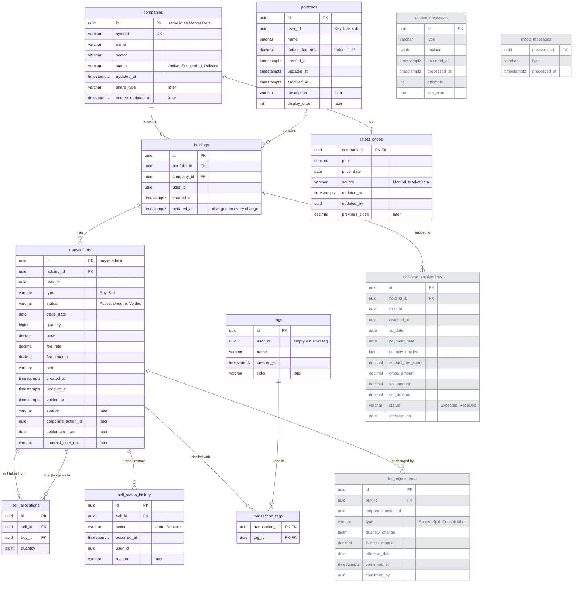

# portfolio_db ER Diagram

Tables and relationships for `portfolio_db`. Column details: [../portfolio-db.md](../portfolio-db.md).

Grey tables and columns marked `later` are added later (corporate actions, dividends, events). Types are simplified here (`decimal` = `numeric(18,2)` or `numeric(7,4)`); exact types are in the column tables.

